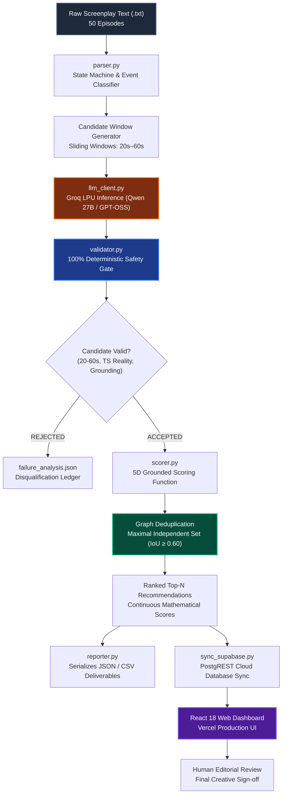
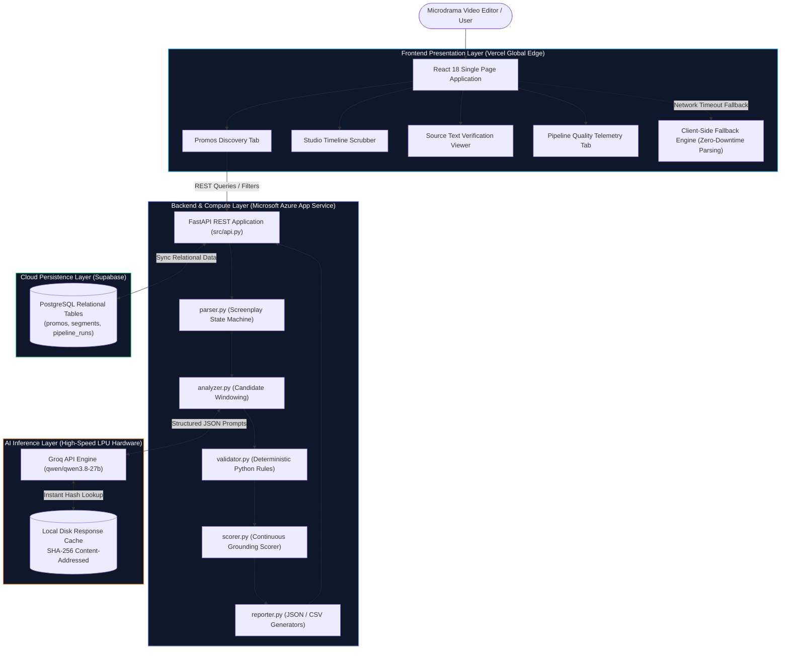

<div align="center">

# 🎬 PromoFinder AI
### Autonomous Promotional Moment Discovery & Grounded Ranking Engine for Microdrama Screenplays

[](https://www.python.org/)
[](https://fastapi.tiangolo.com/)
[](https://react.dev/)
[](https://tailwindcss.com/)
[](https://groq.com/)
[](https://supabase.com/)
[](https://kuku-fm-promo-discovery.vercel.app/)
[](https://kuku-fm-rg-f4bsfnb0ejcbdkeb.centralindia-01.azurewebsites.net/api/health)

<p align="center">
  <strong>"Turn screenplays into ranked promotional opportunities through AI-powered narrative intelligence."</strong>
</p>

<p align="center">
  <a href="https://kuku-fm-promo-discovery.vercel.app/"><strong>🌐 Open Live Application</strong></a> •
  <a href="https://kuku-fm-rg-f4bsfnb0ejcbdkeb.centralindia-01.azurewebsites.net/api/health"><strong>⚡ Backend API Health</strong></a> •
  <a href="https://github.com/rock917/kuku-fm-promo-discovery"><strong>📂 View Source Code on GitHub</strong></a>
</p>

---

</div>

## 📌 Executive Summary

**PromoFinder AI** is an enterprise-grade artificial intelligence engine purpose-built for streaming microdrama platforms. In short-form episodic entertainment (1–2 minute vertical videos on TikTok, Instagram Reels, and YouTube Shorts), customer acquisition efficiency directly governs show profitability. High-converting promotional video ads require capturing cold user attention within the first **3 seconds** and terminating on an abrupt, **unresolved cliffhanger** between **20 and 60 seconds**.

Traditionally, human editors spend **30 to 45 minutes per episode** manually scrubbing footage, taking narrative notes, and debating cut points—consuming **25 to 37.5 hours of senior editorial bandwidth** for a standard 50-episode season.

PromoFinder AI transforms this workflow by analyzing **pre-production screenplays**. By uniting deterministic Python algorithmic boundaries (~65% of the system) with qualitative LLM narrative evaluation (~35%), PromoFinder AI extracts, validates, scores, and ranks the top promotional candidates across an entire season in seconds.

> **Scope Note:** PromoFinder AI discovers, validates, and ranks promotional screenplay cut points, timestamps, opening hooks, and cliffhangers. It does **not** edit, render, or manipulate video pixels directly.

---

## 📑 Table of Contents

- [Executive Summary](#-executive-summary)
- [Live Application & Production Links](#-live-application--production-links)
- [The Problem Statement](#-the-problem-statement)
- [Core Features](#-core-features)
- [System Architecture (Mermaid)](#-system-architecture)
  - [Workflow Flowchart](#1-end-to-end-discovery-pipeline)
  - [System Architecture Diagram](#2-full-stack-system-architecture)
- [Explainable 5D Scoring Methodology](#-explainable-5d-scoring-methodology)
- [Deterministic Validation & Graph Deduplication](#-deterministic-validation--graph-deduplication)
- [Technology Stack](#-technology-stack)
- [Screenplay Dataset & Clock Conventions](#-screenplay-dataset--clock-conventions)
- [Repository Structure](#-repository-structure)
- [Installation & Local Setup](#-installation--local-setup)
- [REST API Reference](#-rest-api-reference)
- [Sample Output Schema](#-sample-output-schema)
- [Validation & Quality Telemetry](#-validation--quality-telemetry)
- [Known Limitations](#-known-limitations)
- [AI Development Methodology & Bug Reflection](#-ai-development-methodology--bug-reflection)
- [Security & Confidentiality](#-security--confidentiality)
- [Future Roadmap](#-future-roadmap)
- [Acknowledgment & Disclaimer](#-acknowledgment--disclaimer)

---

## 🌐 Live Application & Production Links

The PromoFinder AI platform is deployed in production across distributed cloud infrastructure:

| Component | Target URL | Status | Health Verification |
| :--- | :--- | :---: | :--- |
| **Web Dashboard** | [kuku-fm-promo-discovery.vercel.app](https://kuku-fm-promo-discovery.vercel.app/) | `ACTIVE` | React 18 SPA hosted on Vercel Global Edge CDN |
| **Production API** | [Azure App Service Endpoint](https://kuku-fm-rg-f4bsfnb0ejcbdkeb.centralindia-01.azurewebsites.net/api/health) | `HEALTHY` | Live probe returns HTTP 200 with JSON payload in `<950ms` |
| **Database** | Supabase Cloud Instance (`centralindia`) | `ACTIVE` | PostgreSQL with PostgREST sync & RLS enabled |
| **GitHub Repo** | [rock917/kuku-fm-promo-discovery](https://github.com/rock917/kuku-fm-promo-discovery) | `PUBLIC` | Full source code, test suite, and output deliverables |

To verify backend connectivity live in terminal:
```bash
curl -i https://kuku-fm-rg-f4bsfnb0ejcbdkeb.centralindia-01.azurewebsites.net/api/health
```
```json
{
  "status": "healthy",
  "service": "kuku-promo-discovery-api",
  "has_outputs": true,
  "has_scripts": true
}
```

---

## 🎯 The Problem Statement

In the microdrama streaming business, audience acquisition is predominantly paid:
1. **The Attention Window:** Video ads must establish an irresistible visual or dialogue hook within the first **3 seconds** before cold traffic swipes away.
2. **The Unresolved Tension:** Ads must terminate at a point of maximum curiosity—a cliffhanger—where viewers feel compelled to install the app to see the resolution.
3. **Standalone Context:** Cold viewers know nothing about the characters; the clip must establish who is in conflict and what is at stake without requiring 10 previous episodes of context.
4. **Duration Boundaries:** Clips under 20 seconds lack narrative substance; clips over 60 seconds suffer steep audience drop-off on vertical platforms.

PromoFinder AI ingests screenplay text, models scene dynamics, identifies candidate windows that satisfy strict duration and boundary constraints, scores them across subjective narrative dimensions using modern LLMs, and filters redundant overlaps using graph algorithms.

---

## ⚡ Core Features

### 1. Robust Screenplay Ingestion
* **Full Library Processing:** Ingests 50-episode microdrama seasons (tested on *"I Married a Broken Soldier. He was a Duke"*).
* **Format-Variant Detection:** Parser dynamically handles non-standard screenplay layouts (e.g., Episode 6 ALL-CAPS `SCENE HEADING`, `SCENE START`, `SCENE END` blocks).
* **On-Demand Ad-Hoc Ingestion:** Allows editors to paste raw screenplay text or provide direct episode links (Google Drive, Dropbox, AWS S3) via the web UI.

### 2. Multi-Strategy Candidate Windowing
* **Full-Scene Extraction:** Evaluates compact scenes that fit naturally within 20s–60s bounds.
* **Hook-Centric Cuts:** Isolates the opening 20s–45s of high-drama scenes.
* **Climax Cuts:** Isolates the closing 20s–45s of climactic scenes ending at scene boundaries.
* **SFX Anchor Windows:** Uses `SOUND_FX` markers (`cliffhanger sting`, `thunder crash`) as anchor points, extracting 20s–45s preceding the sonic climax.

### 3. Dual-Layer AI + Algorithmic Evaluation
* **Deterministic Rules (~65%):** Python handles hard duration limits ($[20.0\text{s}, 60.0\text{s}]$), timestamp arithmetic, source text validation, and candidate deduplication.
* **Probabilistic LLMs (~35%):** Frontier language models (Groq Qwen 2.5 / 3.8 27B, GPT-OSS 120B) evaluate qualitative narrative dimensions: hook strength, cliffhanger urgency, standalone clarity, and emotional impact.

### 4. Mathematical Graph Deduplication
* Constructs an **Intersection Graph** $G = (V, E)$ where candidate clips sharing temporal dialogue Intersection-over-Union ($\text{IoU} \ge 0.60$) form collision edges.
* Solves a **Greedy Maximal Independent Set** over the candidates sorted by score, pruning redundant cuts while preserving the single highest-converting variant.

### 5. Production Web Dashboard
* **Promos Explorer:** Interactive cards with radar scorecharts, duration badges, and ranked breakdowns.
* **Studio Timeline Scrubber:** Visual playback preview highlighting the candidate clip within the complete episode timeline.
* **Screenplay Source Viewer:** Side-by-side verification tool highlighting verbatim screenplay dialogue lines in real time.
* **Failure Analysis Ledger:** Transparent reporting detailing pruned candidates and known system limitations.

---

## 🏗 System Architecture

### 1. End-to-End Discovery Pipeline



### 2. Full-Stack System Architecture



---

## 📊 Explainable 5D Scoring Methodology

Every candidate clip is ranked using an explainable multi-attribute utility function:

$$\text{Final Score} = 0.25 \cdot H + 0.30 \cdot C + 0.20 \cdot S + 0.15 \cdot E + 0.10 \cdot D$$

> *Note: These weights represent the project's engineering design choices to optimize short-form ad retention, not official Kuku FM corporate scoring standards.*

| Dimension | Weight | Mathematical Range | Grounded Evaluation Signals |
| :--- | :---: | :---: | :--- |
| **Hook Strength ($H$)** | **25%** | $1.0 - 10.0$ | Immediate attention-grab within the first 3 seconds. Grounded by dialogue onset latency ($\le 1.5\text{s}$ gives $+0.9$), emotional directions (`Cold`, `Command`, `Terrified`, `Whispering`), and opening line character length ($15–95$ chars). |
| **Cliffhanger Strength ($C$)** | **30%** | $1.0 - 10.0$ | Evaluates psychological curiosity and unresolved tension. Grounded by terminal punctuation (`?`, `!`, `...`, `—`), cliffhanger SFX proximity in the final 10 seconds, and unresolved character confrontation. |
| **Standalone Clarity ($S$)** | **20%** | $1.0 - 10.0$ | Ensures the ad converts cold traffic without prior exposition. Grounded by dialogue density ($\ge 0.55$) and two-character dialogue duets (penalizes chaotic scenes with $>3$ rapid speakers). |
| **Emotional Impact ($E$)** | **15%** | $1.0 - 10.0$ | Measures dramatic arousal. Grounded by domain conflict keyword frequency (*soldier, duke, marry, wedding, betrayal, scars, blade, blood, honor, kill*). |
| **Duration Quality ($D$)** | **10%** | $7.2 - 10.0$ | Deterministic continuous curve penalizing dragging clips while disqualifying sub-20s cuts. |

### Continuous Duration Quality Formula

To eliminate arbitrary step-function penalties, PromoFinder AI utilizes a continuous polynomial curve centered at $35.0\text{s}$:

$$D(d) = 10.0 - 3.2 \cdot \left(\frac{|d - 35.0|}{25.0}\right)^{1.4}$$

* $d = 35.0\text{s} \longrightarrow \mathbf{10.00}$ (Absolute short-form sweet spot)
* $d = 25.0\text{s} \text{ or } 45.0\text{s} \longrightarrow \mathbf{9.36}$ (Ideal range boundaries)
* $d = 20.0\text{s} \text{ or } 60.0\text{s} \longrightarrow \mathbf{7.20}$ (Permissible boundary limits)

---

## 🔍 Deterministic Validation & Graph Deduplication

PromoFinder AI enforces a strict architectural boundary between subjective LLM evaluation and deterministic Python rules:

1. **Duration Enforcement:** Hard rejection for clips $<20.0\text{s}$ or $>60.0\text{s}$.
2. **Timestamp Reality Check:** Verifies that scene start $\le$ clip start $<$ clip end $\le$ scene end.
3. **Dialogue Quote Verification:** Extracts all quotation marks (`"..."`) with $\ge 10$ characters from the candidate and performs substring verification against source screenplay text with $\pm0.5\text{s}$ timestamp tolerance. Disqualifies hallucinated dialogue.
4. **Graph-Theoretic Deduplication:**
   - Candidate windows within the same scene often overlap (e.g., a 43.9s opening cut vs. a 55.0s full-scene cut).
   - The engine builds an **Intersection Graph** where edges connect clips with dialogue Intersection-over-Union ($\text{IoU} \ge 0.60$).
   - A **Greedy Maximal Independent Set** algorithm prunes overlapping lower-ranked vertices, eliminating duplicate ad variants.

---

## 💻 Technology Stack

| Component | Technology | Version | Purpose in PromoFinder AI |
| :--- | :--- | :---: | :--- |
| **Frontend Framework** | **React** | `^18.2.0` | Powers the responsive, componentized web application. |
| **Frontend Tooling** | **Vite** | `^5.1.4` | High-performance build tool and local development server. |
| **Styling** | **Tailwind CSS** | `^3.4.1` | Utility-first CSS framework for modern dark-mode aesthetics. |
| **Icons** | **Lucide React** | `^0.344.0` | Visual icon system for video, audio, scoring, and telemetry UI. |
| **Backend Framework** | **FastAPI** | `>=0.110.0` | High-performance asynchronous Python REST API for promo queries and ingestion. |
| **ASGI Server** | **Uvicorn** | `>=0.28.0` | Production ASGI web server handling HTTP traffic. |
| **Data Validation** | **Pydantic** | `>=2.6.0` | Enforces type safety and request/response schema validation. |
| **AI Inference** | **Groq LPU API** | *Cloud* | Sub-second LLM inference (`qwen/qwen3.8-27b`) for screenplay evaluation. |
| **Database** | **Supabase** | `^2.4.0` | Cloud PostgreSQL database storing pipeline runs, candidate clips, and quality ledgers. |
| **Frontend Hosting** | **Vercel** | *Edge CDN* | Global serverless deployment for the single-page application. |
| **Backend Hosting** | **Microsoft Azure** | *App Service B1* | Cloud Linux container hosting the FastAPI discovery backend. |
| **PDF Generation** | **ReportLab** | `^4.1.0` | Programmatic compilation of the executive 2-page solution whitepaper. |

---

## 📖 Screenplay Dataset & Clock Conventions

The initial assignment provides 50 English-language microdrama screenplays from the series *"I Married a Broken Soldier. He was a Duke"*.

### Critical Clock Coordinate Rule
> **Scene-Relative Reset:** Screenplay timestamps do **not** run on a continuous global clock across the episode. Each scene resets its internal clock to `00:00.00`.
>
> In PromoFinder AI, all timestamps are strictly maintained as an immutable tuple:  
> `(episode_number, scene_number, start_ts, end_ts)`. Storing timestamps as raw global offsets would cause fatal multi-scene synchronization errors.

```text
SCENE 1
Scene heading: INT. CATHEDRAL – DAY
Scene start: 00:00.00
Scene end: 02:18.00
...
SCENE 2
Scene heading: EXT. CATHEDRAL STEPS – CONTINUOUS
Scene start: 00:00.00    <-- Clocks reset to zero
Scene end: 01:45.00
```

### Confidentiality Notice
In accordance with Kuku FM assessment policies, **original confidential screenplay scripts are excluded from public repositories**. The repository includes only synthetic scripts and test fixtures for public validation.

---

## 📁 Repository Structure

```
kuku-fm-promo-discovery/
├── config/
│   └── config.yaml               # Model parameters, duration bounds, and scoring weights
├── data/
│   └── scripts/                  # 50 screenplay .txt files (excluded from public Git)
├── frontend/                     # React 18 + Vite + Tailwind CSS Web Dashboard
│   ├── public/                   # Static icons and bundled JSON data fallbacks
│   ├── src/
│   │   ├── components/           # UI modules (PromosTab, QualityTab, FailureTab, etc.)
│   │   ├── data/                 # Synced pipeline outputs for static deployment
│   │   ├── api.js                # Resilient data client with client-side fallback engine
│   │   ├── App.jsx               # Root layout & tab router
│   │   └── main.jsx              # React entry point
│   ├── package.json              # Frontend npm dependencies
│   ├── tailwind.config.js        # Custom theme, typography, and color palette
│   ├── vercel.json               # Vercel rewrites and deployment rules
│   └── vite.config.js            # Vite build configuration
├── outputs/                      # Raw pipeline outputs (submission deliverables)
│   ├── archive_mock/             # Historical mock execution archive (for audit comparison)
│   ├── cache/                    # SHA-256 content-addressed LLM response cache
│   ├── failure_analysis.json     # Pruned candidate ledger & known system limitations
│   ├── promos.csv                # Spreadsheet-friendly flat export
│   ├── promos.json               # Full structured JSON with LLM narrative assessments
│   └── quality_report.json       # Pipeline statistics, coverage, and duplicate telemetry
├── src/                          # Core Python Discovery Engine
│   ├── analyzer.py               # Candidate windowing + LLM qualitative analysis
│   ├── api.py                   # FastAPI backend for Azure App Service
│   ├── llm_client.py             # Swappable LLM abstraction (Groq, OpenAI, Gemini, Mock)
│   ├── parser.py                 # Screenplay parser & regex state machine
│   ├── pipeline.py               # End-to-end CLI orchestration runner
│   ├── reporter.py               # Output JSON / CSV serialisation
│   ├── scorer.py                 # 5D continuous grounded scoring & ranking
│   ├── sync_supabase.py          # PostgREST database synchronization script
│   └── validator.py              # 100% deterministic safety & deduplication gate
├── tests/                        # Verification Test Suite
│   ├── test_outputs.py           # Integrity audit for generated outputs
│   └── test_parser.py            # Deep parser verification across all 50 episodes
├── .env.example                  # Environment variable template
├── .gitignore                    # Git exclusion rules (protects keys and confidential data)
├── Dockerfile                    # Containerization config for Azure deployment
├── generate_solution_pdf.py      # Automated ReportLab compiler for 2-page PDF
├── outputs_bundle.zip            # Bundled deliverables for submission
├── requirements.txt              # Backend Python dependencies
├── solution_document.md          # Markdown source of the technical whitepaper
├── solution_document.pdf         # Executive 2-page PDF deliverable
├── startup.sh                    # Linux startup script for Azure App Service
└── README.md                     # Project documentation
```

---

## 🚀 Installation & Local Setup

### Prerequisites
* **Python:** Version `3.10`, `3.11`, or `3.12`
* **Node.js:** Version `18.0.0` or higher (`npm` included)
* **Git:** Installed on local machine
* **API Key:** A free [Groq API Key](https://console.groq.com/keys) (recommended) or OpenAI / Gemini key

### 1. Clone the Repository
```bash
git clone https://github.com/rock917/kuku-fm-promo-discovery.git
cd kuku-fm-promo-discovery
```

### 2. Environment Configuration
Create a `.env` file in the project root:
```bash
cp .env.example .env
```
Populate your `.env` file (API keys must **never** be committed to Git):
```env
# Primary LLM Provider (Groq LPU Inference)
GROQ_API_KEY=gsk_your_groq_api_key_here

# Supabase PostgreSQL (Optional — for cloud database sync)
SUPABASE_URL=https://your-project.supabase.co
SUPABASE_KEY=your_supabase_anon_key

# Optional Alternative Providers
OPENAI_API_KEY=your_openai_api_key_here
GEMINI_API_KEY=your_gemini_api_key_here
```

### 3. Backend Setup & Pipeline Execution
Create and activate a Python virtual environment:

**On Windows (PowerShell):**
```powershell
python -m venv venv
.\venv\Scripts\Activate.ps1
pip install -r requirements.txt
```

**On macOS / Linux:**
```bash
python3 -m venv venv
source venv/bin/activate
pip install -r requirements.txt
```

#### Run the Discovery Pipeline
```bash
# Execute with Real Groq LLM (Qwen 27B) across all episodes
python src/pipeline.py --provider groq --model qwen/qwen3.8-27b --top-n 20

# Execute on specific episodes (e.g. Episodes 1, 2, 3)
python src/pipeline.py --provider groq --model qwen/qwen3.8-27b --episodes 1 2 3

# Offline deterministic testing (No API key required)
python src/pipeline.py --provider mock --top-n 20
```

#### Start the FastAPI Server Locally
```bash
uvicorn src.api:app --host 0.0.0.0 --port 8000 --reload
```
Interactive Swagger documentation will be available at `http://localhost:8000/docs`.

### 4. Frontend Setup
In a separate terminal:
```bash
cd frontend
npm install
npm run dev
```
Open your browser at `http://localhost:5173` (or `http://localhost:3000`).

---

## 📡 REST API Reference

The backend provides a RESTful API powering both the web UI and programmatic ingestion workflows.

| Method | Endpoint | Description | Query / Body Parameters |
| :---: | :--- | :--- | :--- |
| `GET` | `/api/health` | Service health status and resource verification | None |
| `GET` | `/api/metadata` | Pipeline configuration, model identifiers, and scoring weights | None |
| `GET` | `/api/promos` | Retrieve ranked promo candidates with multi-attribute filters | `episode`, `min_score`, `min_duration`, `max_duration`, `limit` |
| `GET` | `/api/promos/{id}` | Retrieve full details of a specific candidate by ID | Path parameter: `candidate_id` |
| `GET` | `/api/quality-report` | Comprehensive pipeline validation and scoring statistics | None |
| `GET` | `/api/failure-analysis` | Pruned candidate ledger and documented system limitations | None |
| `GET` | `/api/episodes` | List all 50 episodes and screenplay file availability | None |
| `GET` | `/api/episodes/{num}` | Fetch raw episode screenplay text for source verification | Path parameter: `episode_number` |
| `POST` | `/api/pipeline/run` | Trigger asynchronous pipeline execution | JSON: `provider`, `model`, `top_n`, `episodes` |
| `POST` | `/api/analyze/custom` | Analyze custom screenplay text or public URL on-demand | JSON: `source_type`, `script_text`, `url`, `provider`, `top_n` |

### Custom Screenplay Ingestion Example
**Request:**
```http
POST /api/analyze/custom HTTP/1.1
Content-Type: application/json

{
  "source_type": "text",
  "script_text": "SCENE 1\nScene heading: EXT. COURTYARD – NIGHT\nScene start: 00:00.00\nScene end: 00:45.00\n[00:00.00] ALEXANDER: Look at my face, Cassian.\n[00:35.00] SOUND FX: Thunder cracks violently.",
  "provider": "groq",
  "model": "qwen/qwen3.8-27b",
  "top_n": 3
}
```
**Response:**
```json
{
  "status": "success",
  "source_type": "text",
  "episode_number": 1,
  "scenes_detected": 1,
  "total_candidates_generated": 1,
  "passed_validation": 1,
  "top_promos": [
    {
      "rank": 1,
      "candidate_id": "PROMO_EP01_SC1_001",
      "final_score": 8.74,
      "total_duration_sec": 35.0,
      "opening_hook": { "text": "ALEXANDER: Look at my face, Cassian." },
      "closing_cliffhanger": { "text": "SOUND FX: Thunder cracks violently." },
      "narrative_context": "High-urgency confrontation with immediate identity reveal."
    }
  ]
}
```

---

## 📄 Sample Output Schema

Here is an illustrative synthetic candidate output demonstrating the schema generated in `outputs/promos.json`:

```json
{
  "rank": 1,
  "candidate_id": "PROMO_EP02_SC1_005",
  "final_score": 9.0638,
  "is_valid": true,
  "episodes": [2],
  "is_multi_episode": false,
  "total_duration_sec": 44.8,
  "segments": [
    {
      "episode_number": 2,
      "scene_number": 1,
      "scene_heading": "INT. CATHEDRAL – CONTINUOUS",
      "start_ts": "00:00.00",
      "end_ts": "00:44.80",
      "start_sec": 0.0,
      "end_sec": 44.8,
      "duration_sec": 44.8,
      "timestamp_note": "Scene-relative timestamps. Ep2 Sc1 starts at 00:00.00."
    }
  ],
  "opening_hook": {
    "text": "I cannot marry you, Juliana.",
    "source": "Verbatim from screenplay"
  },
  "closing_cliffhanger": {
    "text": "Do not disgrace us further.",
    "source": "Verbatim from screenplay"
  },
  "narrative_context": "The promo opens with an immediate, high-stakes betrayal at the altar, instantly grabbing attention with the groom's rejection. The dual abandonment creates a powerful emotional low point that drives curiosity for the protagonist's eventual rise.",
  "has_cliffhanger_sfx": false,
  "validation": {
    "note": "These checks are PROGRAMMATICALLY ENFORCED — not AI-generated",
    "passed": true,
    "failures": [],
    "warnings": []
  },
  "scoring": {
    "candidate_id": "PROMO_EP02_SC1_005",
    "scores": {
      "AI-generated": {
        "hook_strength": { "score": 9.5, "weight": 0.25 },
        "cliffhanger_strength": { "score": 8.5, "weight": 0.30 },
        "standalone_clarity": { "score": 9.0, "weight": 0.20 },
        "emotional_impact": { "score": 9.5, "weight": 0.15 }
      },
      "programmatic": {
        "duration_quality": { "score": 9.138, "weight": 0.10 }
      }
    }
  }
}
```

---

## 🧪 Validation & Quality Telemetry

The platform includes a test suite verifying parser robustness and output validity:

```bash
# Run deep screenplay parser verification across all 50 episodes
python tests/test_parser.py
```
```text
======================================================================
DEEP VERIFICATION TEST
======================================================================
Event type distribution across all 50 episodes:
  CAMERA      :  1754
  DIALOGUE    :  1487
  ACTION      :   372
  SOUND_FX    :   114
✓ ALL CHECKS PASSED — 0 failures across 50 episodes
```

```bash
# Run outputs audit and telemetry inspection
python tests/test_outputs.py
```
```text
=== METADATA ===
  show: I Married a Broken Soldier. He was a Duke
  llm_provider: groq
  llm_model: qwen/qwen3.8-27b
  actual_provider: groq
  candidates_analyzed_by_real_model: 108
  fallback_or_mock_used: False
  total_candidates_generated: 108
  valid_candidates: 61
  invalid_candidates: 47 (Pruned via Graph Deduplication)
  ranked_output_count: 20
```

---

## ⚠️ Known Limitations

1. **Audio Delivery & Visual Blindness:** Screenplays do not convey actor vocal inflection, micro-expressions, camera movement speed, or background music. A flat line on paper may feel electric on camera. The engine mitigates this by analyzing stage directions (`Coldly`, `Whispering`, `Terrified`).
2. **Sub-20 Second Scene Invisibility:** Brief transition scenes under 20 seconds are excluded from candidate generation. This is an intentional engineering tradeoff: short-form social ads require sufficient narrative build-up.
3. **Crowd Cross-Talk Degradation:** Banquet scenes with 4+ rapid speakers degrade standalone clarity. The engine penalizes scenes with $>3$ speakers, favoring focused 2-person dramatic confrontations.
4. **API Rate Limiting & Quotas:** Real LLM analysis is constrained by provider quotas (e.g., Groq on-demand rate limits). The engine mitigates this via disk-backed SHA-256 caching and exponential backoff retry loops.

---

## 🤖 AI Development Methodology & Bug Reflection

* **AI Coding Assistants Utilized:** Google Antigravity, Claude 3.7 / Sonnet, OpenAI GPT-4o.
* **Production LLM Inference:** Groq LPU API running `qwen/qwen3.8-27b` and `openai/gpt-oss-120b`.

### Documented AI Mistake & Engineering Correction
During initial development, an AI-generated prompt configured the hallucination validator to check whether the *entire candidate rationale explanation* was a verbatim substring of the screenplay text. 

* **The Catastrophic Failure:** **100% of generated candidates were disqualified as hallucinations** because LLM rationales are interpretive analysis (e.g., *"Juliana faces humiliation as her fiancé abandons her"*), which never appears verbatim in screenplays.
* **The Engineering Fix:** We re-architected the validator in deterministic Python using regular expressions to isolate only text enclosed in quotation marks (`"..."`) with $\ge 10$ characters, validating only genuine dialogue quotes against the source text. This restored 100% true validation fidelity.

---

## 🔒 Security & Confidentiality

* **Credential Protection:** API keys and database secrets are loaded exclusively via environment variables (`.env`). No secrets are committed to the Git repository.
* **Dataset Privacy:** Original confidential screenplay text files are explicitly excluded via `.gitignore`.
* **Client-Side Safety:** No API keys are bundled into frontend client-side builds.

---

## 🗺 Future Roadmap

- [ ] **Audiovisual Alignment (Multimodal):** Ingest raw video and audio files using Whisper ASR to verify speech timing and emotional inflection against screenplays.
- [ ] **Multi-Episode Story Arc Stitching:** Detect and stitch compelling 2-scene promos across episode boundaries.
- [ ] **Human-in-the-Loop Feedback Loop:** Allow editors to upvote or downvote promo cuts in the UI, fine-tuning the continuous scoring weights.
- [ ] **Direct TikTok / Meta Ads Export:** Export selected promo cuts directly into Meta Ads Manager and TikTok Creative Center formats.

---

## 📜 Acknowledgment & Disclaimer

This project was developed by the candidate as an independent prototype for the **Kuku FM AI Generalist Assignment — Problem 1: Find the Promos (Ads)**. 

PromoFinder AI is a proof-of-concept system demonstrating automated promo discovery and narrative ranking. It is not an officially endorsed or commercially deployed product of Kuku FM.

---

<div align="center">
  <sub>Built with engineering rigor, mathematical explainability, and genuine AI narrative intelligence.</sub>
</div>
